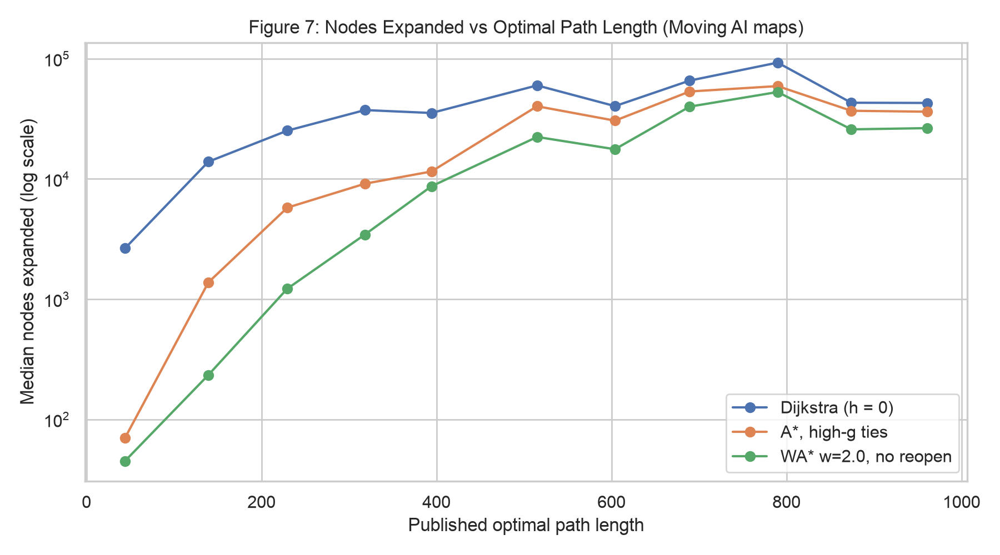
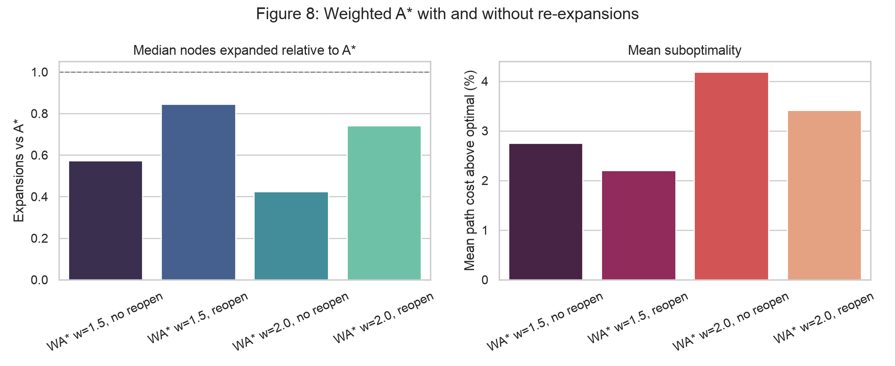
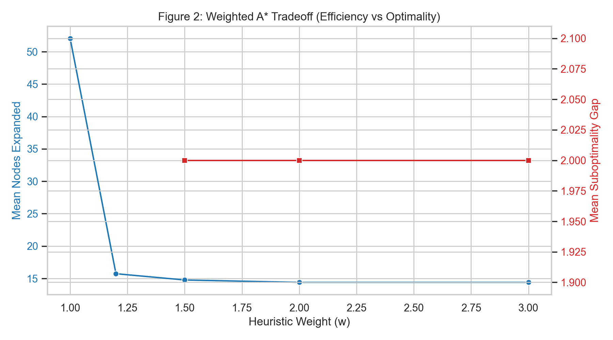
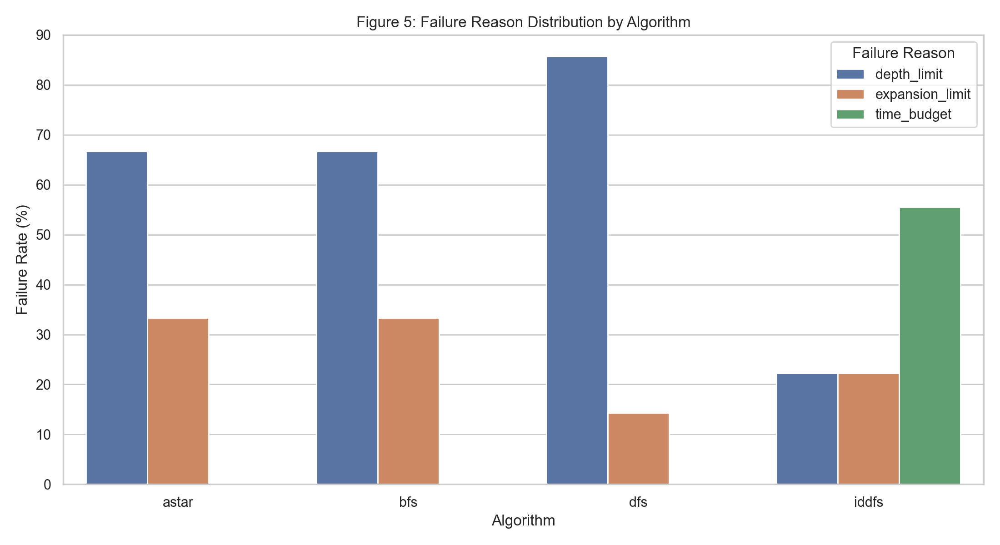
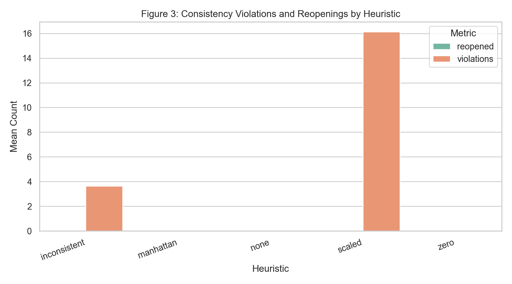
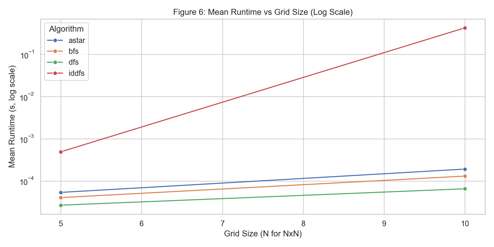

# Classical Search Algorithms: Implementation, Theory and Benchmarks

BFS, DFS, IDDFS and A* implemented from scratch in pure Python, evaluated in two ways:

1. **Theory experiments on generated grids** (the original Northeastern course project): each A* guarantee
   from Hart, Nilsson & Raphael (1968) — admissibility, consistency, re-expansion — measured directly, plus
   behaviour under depth, expansion and wall-clock limits. Full write-up: [`docs/report.pdf`](docs/report.pdf).
2. **The Moving AI Lab benchmark** (Sturtevant, 2012), the standard test set for grid pathfinding: 500
   problems on 10 real game and city maps, every one with a published optimal answer to check against.

## Results at a glance

| Check | Result |
|---|---|
| Optimal algorithms vs published optima, 500 benchmark problems | **500 / 500 match** (Dijkstra and A*, to within 1e-4) |
| A* vs Dijkstra, median nodes expanded | **4.95× fewer** (2.2× on game maps, 12× on city maps) |
| Weighted A* (w = 2) without re-expansions vs A* | **2.4× fewer expansions**, paths 4.2% longer on average |
| Weighted A* suboptimality bound (cost ≤ w × optimal) | **Held on every problem** (worst case 26.8% above optimal at w = 2, bound 100%) |
| Admissible heuristics on generated grids, 270 runs | **100% optimal**; weighted A* 86.7–100% optimal depending on w |
| Property tests across 40 random grids per guarantee | **415 tests pass** |

## Benchmark: Moving AI maps

Six Dragon Age: Origins maps (194×194 to 481×530) and four 256×256 city street maps, 50 problems each,
sampled evenly across the difficulty buckets of each scenario file (path lengths 1 to 1,018). Movement is
8-directional with diagonal cost √2 and no corner cutting — the benchmark's own rules — so path costs are
directly comparable with the published optima.

| Algorithm | Matches optimum | Mean / max cost above optimal | Expansions vs A* (median) | Mean re-expansions |
|---|---|---|---|---|
| Dijkstra (A* with h = 0) | 100% | 0 / 0% | 4.95× | 0 |
| A*, octile heuristic | 100% | 0 / 0% | 1.00× | 0 |
| Weighted A*, w = 1.5, re-expanding | 33% | 2.2 / 14.8% | 0.85× | 12,614 |
| Weighted A*, w = 1.5, no re-expansion | 27% | 2.8 / 15.6% | **0.57×** | 0 |
| Weighted A*, w = 2.0, re-expanding | 26% | 3.4 / 26.8% | 0.74× | 16,333 |
| Weighted A*, w = 2.0, no re-expansion | 22% | 4.2 / 26.8% | **0.42×** | 0 |

What the benchmark shows:

- **The heuristic matters most where the map is open.** On city maps A* expands 12× fewer nodes than
  Dijkstra; on maze-like game maps, where walls make straight-line distance a weaker guide, 2.2×. For short
  paths the gap is 35× (median 80 vs 2,841 expansions); for paths over 800 it shrinks to 1.16×, because both
  searches end up covering most of the map.
- **Re-expansions are where weighted A* loses its speed.** With w > 1 the heuristic is inconsistent, so A*
  keeps finding cheaper paths to nodes it already expanded. Re-expanding them costs 1.5–1.8× the work for
  under a percentage point of path quality; skipping them keeps the w-suboptimality guarantee and is the
  faster choice.
- **Tie-breaking made no measurable difference** (FIFO vs larger-g: 1.01×). With √2 diagonal costs, exact
  ties in f are rare, so the textbook advice to break ties towards larger g has little to act on here.




Raw results: [`results/benchmark_results.csv`](results/benchmark_results.csv) (3,500 runs) ·
summary: [`results/benchmark_summary.json`](results/benchmark_summary.json) ·
tie-breaking per map: [`figures/fig9_tie_breaking.png`](figures/fig9_tie_breaking.png).

## Theory experiments on generated grids

Seeded random 4-directional grids (5×5 and 10×10, obstacle densities 0–20%, five seeds), with BFS as the
optimal-cost reference.

- Every admissible A* variant (h = 0, Manhattan, scaled w ≤ 1, and an admissible-but-inconsistent heuristic)
  matched BFS cost on **100%** of 270 runs.
- Weighted A*: w = 1.2 stayed 100% optimal; w = 1.5 fell to 93.3%; w = 2.0 and 3.0 to 86.7%. Whenever a
  gap appeared it was exactly 2 steps. Mean expansions fell from ~52 (w = 1) to ~16 (w = 1.2) and ~14.
- The inconsistent heuristic triggered consistency violations while remaining optimal, separating
  "violations observed" from "optimality lost".
- Under resource limits, IDDFS failed most often (27 of 192 constrained runs), mostly on time budgets: its
  repeated deepening costs 928 expansions on an empty 5×5 grid where BFS and A* need 25.

| | |
|---|---|
|  |  |
|  |  |

## Implementation

```
environment/
  grid_world.py   grid, successors (4- or 8-directional, no corner cutting), Manhattan and octile distances
  movingai.py     Moving AI .map / .scen parser
algorithms/
  bfs.py, dfs.py, iddfs.py
  astar_theory.py A*: explicit open/closed lists, optional re-expansion, tie-breaking policy,
                  online consistency checks, node and memory counters
  heuristics.py   zero, Manhattan, scaled, inconsistent, octile, scaled octile
evaluation/
  runner.py, theory_experiments.py   course experiments
  benchmark.py, summarize_benchmark.py
```

Every algorithm honours the same resource limits (`max_depth`, `max_expansions`, `time_budget_seconds`) and
reports why it stopped. Things worth knowing about the A* implementation:

- **Floating-point tolerance.** √2 step costs make two equally short paths differ by ~1e-15, which a naive
  `new_g < old_g` comparison treats as an improvement — A* then "re-opens" nodes it should not and the
  consistency checker flags violations that do not exist. Comparisons use a 1e-9 tolerance; a property test
  asserts that A* with a consistent heuristic never re-opens a node.
- **Defaults reproduce the course results.** The tie-breaking, re-expansion and 8-directional options all
  default to the original behaviour; re-running the theory sweep reproduces all 270 committed results
  exactly.

## Run it

Python 3.10+; the algorithms use only the standard library.

```bash
pip install -r requirements.txt
python main.py                    # four algorithms on the default grid
python main.py --all              # baseline vs constrained runs
make test                         # 415 unit and property tests
make reproduce                    # course experiments, Moving AI benchmark (~5 min), figures
```

Other entry points:

```bash
python main.py --heuristic scaled --weight 1.5      # weighted A*
python main.py --heuristic inconsistent --trace     # watch re-expansions and consistency violations
python main.py --theory-report                      # theory validation report
python -m evaluation.benchmark --per-map 5 --quick  # fast benchmark check
```

## References

- P. E. Hart, N. J. Nilsson and B. Raphael, "A formal basis for the heuristic determination of minimum cost
  paths," *IEEE Transactions on Systems Science and Cybernetics*, 4(2), 1968.
- N. Sturtevant, "Benchmarks for grid-based pathfinding," *IEEE Transactions on Computational Intelligence
  and AI in Games*, 4(2), 2012. Maps and scenarios from [movingai.com/benchmarks](https://movingai.com/benchmarks/).
